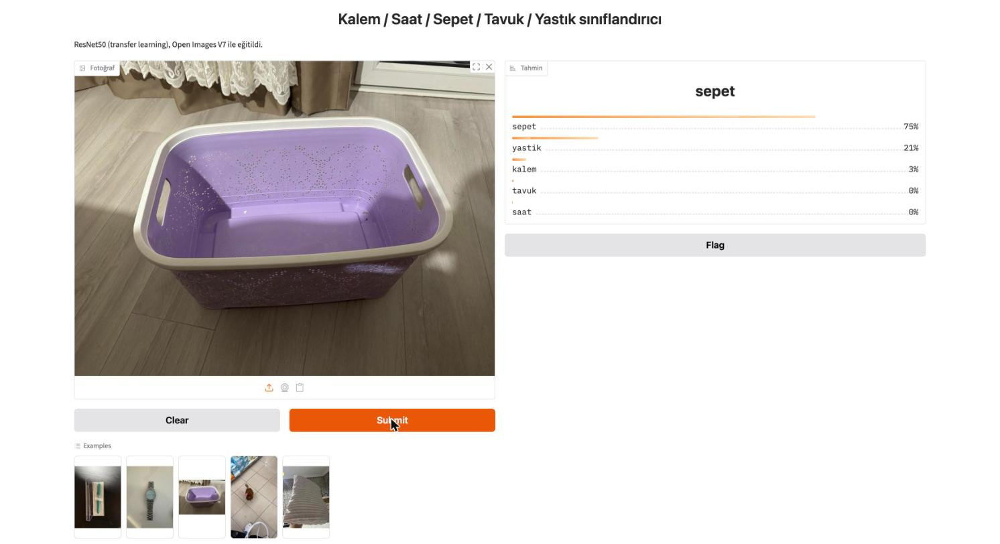

# Image Classification with Transfer Learning (ResNet50)

Deep Learning course, Homework 2 (Computer Vision). İsa Mirza Sincap, 23120205033.

I photographed five everyday objects with my phone (pen, watch, basket, chicken, pillow) and trained a
5-class image classifier for them. The training data comes from Open Images V7. The model is an
ImageNet-pretrained ResNet50 fine-tuned with Keras, and it is served as a small Gradio app.

## Files

| File | Description |
|---|---|
| `cnn_open_images.ipynb` | Full pipeline with outputs: data download, training, evaluation, own-photo test, Gradio app, report table |
| `fotograflar/` | My five test photos (the file name is the true class). The name engraved on the pen is blurred. |
| `gradio_ekran.jpg` | Screenshot of the Gradio app |

## Classes

| Class (Turkish) | English | Open Images labels used |
|---|---|---|
| kalem | pen | Pen, Fountain pen |
| saat | watch | Watch |
| sepet | basket | Basket, Laundry basket, Storage basket, Picnic basket |
| tavuk | chicken | Chicken |
| yastik | pillow | Pillow, Cushion |

## Dataset

[Open Images V7](https://storage.googleapis.com/openimages/web/index.html) (Google; annotations CC BY 4.0,
images listed as CC BY 2.0). I used the human-verified image-level labels of the validation and test
splits, kept images that contain exactly one of the five classes, and re-split them 70/15/15
(stratified) into train / validation / test.

## Model and training

- ResNet50 (ImageNet weights, no top) + GlobalAveragePooling + Dropout(0.3) + Dense(5, softmax)
- Input 224x224x3, augmentation: horizontal flip, ±10% rotation, ±10% zoom
- Loss: categorical cross-entropy, class weights for the imbalanced classes
- Stage 1: frozen backbone, Adam lr 1e-3, up to 10 epochs (early stopping, patience 3)
- Stage 2: unfreeze the `conv5` block, Adam lr 1e-5, up to 6 epochs
- Batch size 32, seed 33

## Results

Trained on a Google Colab T4 GPU (TensorFlow 2.21 / Keras 3). Training time: 131 s.

| Metric (test set, 228 images) | Value |
|---|---|
| Accuracy | 0.873 |
| Macro F1 | 0.859 |
| Inference time, batched | 28.3 ms / image |
| Inference time, single image | 228 ms |

| Class | Precision | Recall | F1 |
|---|---|---|---|
| kalem | 0.786 | 0.815 | 0.800 |
| saat | 0.792 | 0.826 | 0.809 |
| sepet | 0.873 | 0.800 | 0.835 |
| tavuk | 0.949 | 0.925 | 0.937 |
| yastik | 0.890 | 0.936 | 0.912 |

Most errors come from small objects in cluttered scenes (Open Images labels mean "somewhere in this
image there is a pen") and from basket → pillow confusion.

**My own photos: 5/5 correct.**

| Photo | True | Predicted | Probability |
|---|---|---|---|
| kalem.jpg | kalem | kalem | 0.970 |
| saat.jpg | saat | saat | 1.000 |
| sepet.jpg | sepet | sepet | 0.747 |
| tavuk.jpg | tavuk | tavuk | 0.982 |
| yastik.jpg | yastik | yastik | 0.999 |

The basket was the hardest one (21% pillow): most Open Images baskets are wicker, mine is a plastic
laundry basket.

## Gradio app

## How to run

1. Open `cnn_open_images.ipynb` in Google Colab and select a GPU runtime (T4).
2. Upload the `fotograflar/` folder to the Colab files panel.
3. Run all cells. The data download takes about a minute; the Gradio cell prints a public link.
